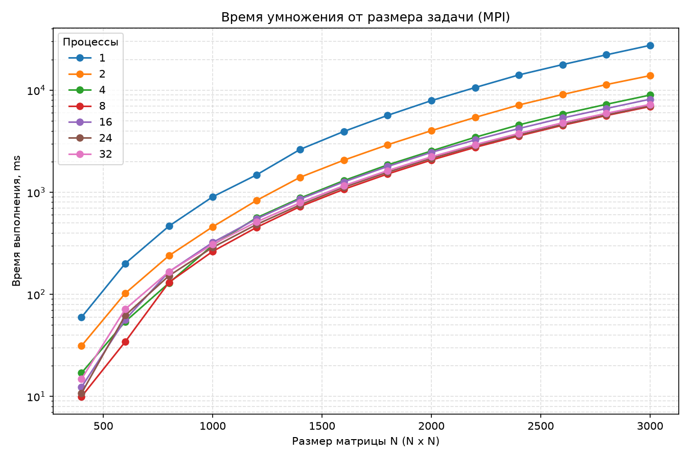
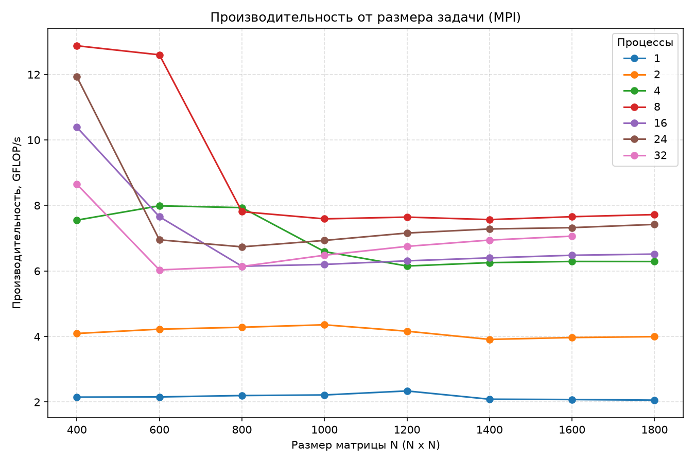
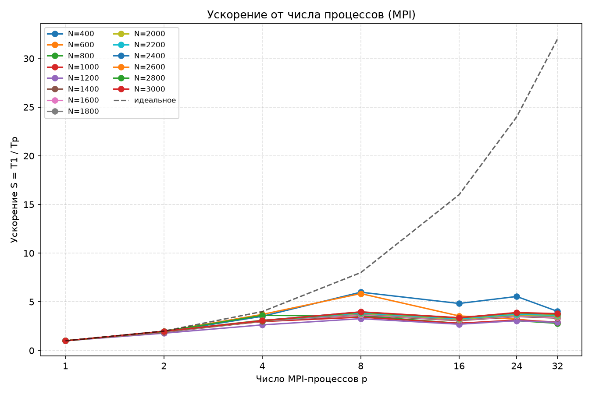
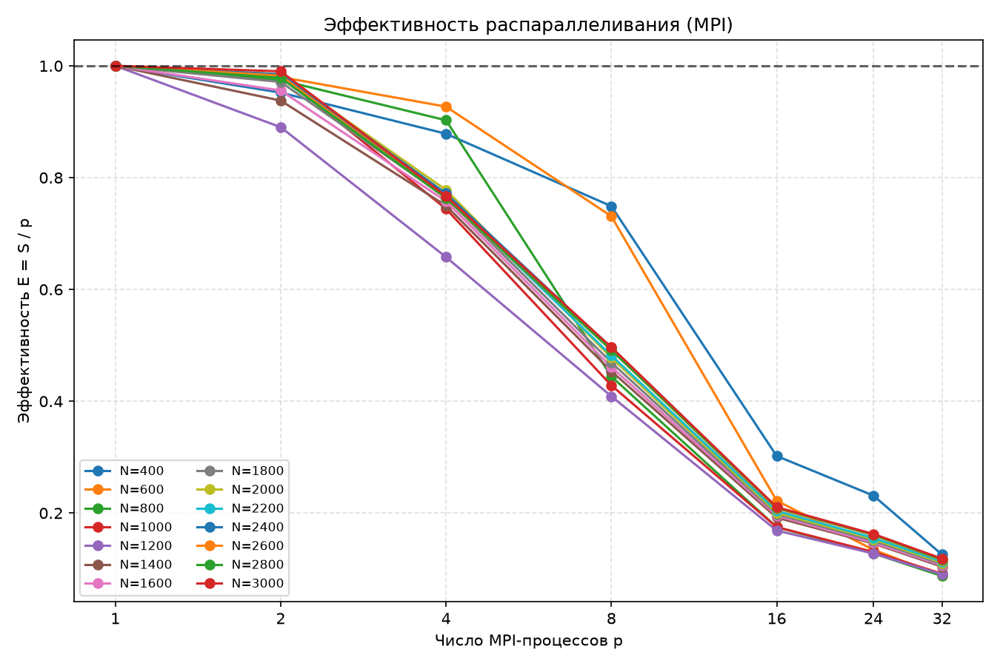
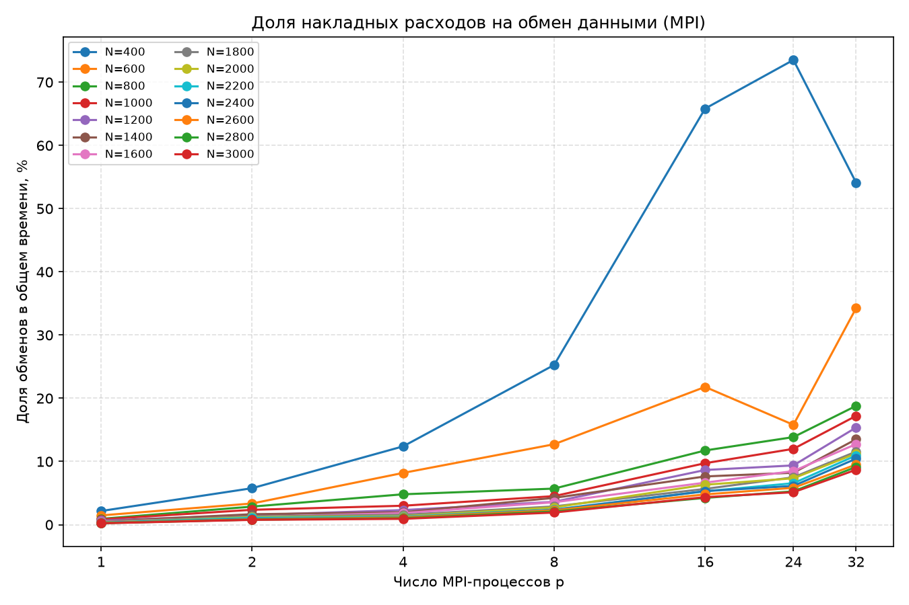
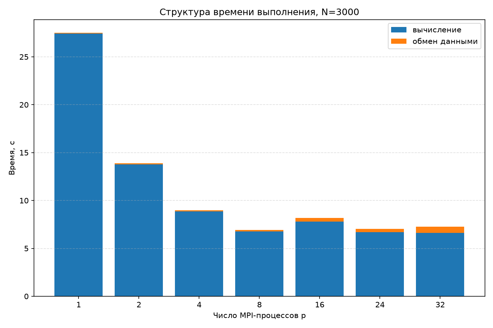

# Лабораторная работа № 3

Общие требования, подход к исследованию и методика проведения замеров описаны в [корневом README.md](../../README.md).

## Задача


Распараллелить алгоритм умножения двух квадратных матриц с помощью MPI и исследовать зависимость времени выполнения, ускорения `S` и эффективности `E` распараллеливания от размера матрицы и количества вычислительных MPI-процессов, запускаемых на одном вычислительном узле суперкомпьютера "Сергей Королёв". Результат работы алгоритма необходимо верифицировать с помощью сторонних библиотек на языке Python.

## Алгоритм

Используется ленточная схема распределения данных. Пусть `A` имеет размер `n × m`, `B` - `m × p`, `p_mpi` - число процессов.

1. Корневой процесс читает матрицы из JSON и рассылает размеры задачи `MPI_Bcast`.
2. Матрица `B` целиком рассылается всем процессам `MPI_Bcast`.
3. Строки матрицы `A` делятся на `p_mpi` полос и раздаются процессам `MPI_Scatterv`. Каждый процесс получает `n / p_mpi` строк, первые `n mod p_mpi` процессов - на одну строку больше, поэтому нагрузка сбалансирована с точностью до одной строки.
4. Каждый процесс умножает свою полосу на `B` тем же тройным циклом `i-k-j`, что и в лабораторной работе 1.
5. Полосы результата собираются на корневом процессе `MPI_Gatherv`.

```cpp
for (std::uint32_t i = 0; i < local_rows; ++i)
{
    double *c_row = c_ptr + i * p;
    for (std::uint32_t k = 0; k < m; ++k)
    {
        const double a_ik = a_ptr[i * m + k];
        const double *b_row = b_data + k * p;
        for (std::uint32_t j = 0; j < p; ++j)
        {
            c_row[j] += a_ik * b_row[j];
        }
    }
}
```

Процессы не обмениваются данными во время вычислений: каждая строка результата зависит только от своей строки `A` и всей матрицы `B`. Обмены сосредоточены до `Bcast`, `Scatterv` и после `Gatherv` вычислительной части.

### Предварительная оценка алгоритма

* `O(n · m · p / p_mpi)` - вычисления на процесс.
* Обмены: рассылка `B` - `m · p` чисел каждому процессу (при древовидной реализации MPI_Bcast - `O(m · p · log p_mpi)` по времени), раздача `A` и сбор `C` - по `n · m` и `n · p` чисел суммарно.
* Память: каждый процесс хранит всю матрицу `B` и свои полосы `A` и `C`: `O(m · p + (n · m + n · p) / p_mpi)`.

Для квадратных матриц одинаковой размерности `N` вычисления масштабируются как `N³ / p_mpi`, а обмены - как `N²`. Поэтому доля обменов уменьшается с ростом `N` и растёт с ростом `p_mpi`; на малых матрицах ускорение ограничено накладными расходами, на больших - приближается к линейному.

## Технические характеристики вычислительной среды

[Кластер "Сергей Королёв"](https://hpc.ssau.ru/node/6)


## Результаты

Из 98 запусков все 98 признаны корректными, по результатам проверки `gen_reference.py`. Для каждого размера `N` контрольные суммы `checksum` и `checksum_sq` совпадают у всех семи конфигураций по числу процессов.

### Время, с

| N | p = 1 | p = 2 | p = 4 | p = 8 | p = 16 | p = 24 | p = 32 |
|---:|---:|---:|---:|---:|---:|---:|---:|
| 400 | 0.05956 | 0.03128 | 0.01695 | 0.009941 | 0.01232 | 0.01073 | 0.0148 |
| 600 | 0.2005 | 0.1023 | 0.05407 | 0.03429 | 0.05642 | 0.06215 | 0.07161 |
| 800 | 0.466 | 0.2391 | 0.1291 | 0.1311 | 0.1666 | 0.152 | 0.1668 |
| 1000 | 0.903 | 0.459 | 0.3034 | 0.2635 | 0.3226 | 0.2885 | 0.3086 |
| 1200 | 1.479 | 0.8305 | 0.5618 | 0.4521 | 0.5477 | 0.4828 | 0.5119 |
| 1400 | 2.632 | 1.403 | 0.8774 | 0.7251 | 0.8575 | 0.7537 | 0.7904 |
| 1600 | 3.947 | 2.065 | 1.302 | 1.07 | 1.264 | 1.119 | 1.16 |
| 1800 | 5.671 | 2.92 | 1.855 | 1.511 | 1.79 | 1.572 | 1.631 |
| 2000 | 7.906 | 4.014 | 2.541 | 2.068 | 2.46 | 2.148 | 2.226 |
| 2200 | 10.62 | 5.412 | 3.46 | 2.754 | 3.254 | 2.844 | 2.93 |
| 2400 | 14.12 | 7.166 | 4.573 | 3.565 | 4.214 | 3.646 | 3.772 |
| 2600 | 17.82 | 9.072 | 5.84 | 4.533 | 5.346 | 4.624 | 4.797 |
| 2800 | 22.22 | 11.35 | 7.275 | 5.647 | 6.62 | 5.738 | 5.938 |
| 3000 | 27.5 | 13.89 | 8.964 | 6.921 | 8.16 | 7.049 | 7.257 |

### Ускорение S

| N | p = 1 | p = 2 | p = 4 | p = 8 | p = 16 | p = 24 | p = 32 |
|---:|---:|---:|---:|---:|---:|---:|---:|
| 400 | 1.00 | 1.90 | 3.51 | 5.99 | 4.83 | 5.55 | 4.02 |
| 600 | 1.00 | 1.96 | 3.71 | 5.85 | 3.55 | 3.23 | 2.80 |
| 800 | 1.00 | 1.95 | 3.61 | 3.55 | 2.80 | 3.07 | 2.79 |
| 1000 | 1.00 | 1.97 | 2.98 | 3.43 | 2.80 | 3.13 | 2.93 |
| 1200 | 1.00 | 1.78 | 2.63 | 3.27 | 2.70 | 3.06 | 2.89 |
| 1400 | 1.00 | 1.88 | 3.00 | 3.63 | 3.07 | 3.49 | 3.33 |
| 1600 | 1.00 | 1.91 | 3.03 | 3.69 | 3.12 | 3.53 | 3.40 |
| 1800 | 1.00 | 1.94 | 3.06 | 3.75 | 3.17 | 3.61 | 3.48 |
| 2000 | 1.00 | 1.97 | 3.11 | 3.82 | 3.21 | 3.68 | 3.55 |
| 2200 | 1.00 | 1.96 | 3.07 | 3.86 | 3.26 | 3.73 | 3.62 |
| 2400 | 1.00 | 1.97 | 3.09 | 3.96 | 3.35 | 3.87 | 3.74 |
| 2600 | 1.00 | 1.96 | 3.05 | 3.93 | 3.33 | 3.86 | 3.72 |
| 2800 | 1.00 | 1.96 | 3.05 | 3.93 | 3.36 | 3.87 | 3.74 |
| 3000 | 1.00 | 1.98 | 3.07 | 3.97 | 3.37 | 3.90 | 3.79 |

### Эффективность E

| N | p = 1 | p = 2 | p = 4 | p = 8 | p = 16 | p = 24 | p = 32 |
|---:|---:|---:|---:|---:|---:|---:|---:|
| 400 | 1.00 | 0.95 | 0.88 | 0.75 | 0.30 | 0.23 | 0.13 |
| 600 | 1.00 | 0.98 | 0.93 | 0.73 | 0.22 | 0.13 | 0.09 |
| 800 | 1.00 | 0.97 | 0.90 | 0.44 | 0.17 | 0.13 | 0.09 |
| 1000 | 1.00 | 0.98 | 0.74 | 0.43 | 0.17 | 0.13 | 0.09 |
| 1200 | 1.00 | 0.89 | 0.66 | 0.41 | 0.17 | 0.13 | 0.09 |
| 1400 | 1.00 | 0.94 | 0.75 | 0.45 | 0.19 | 0.15 | 0.10 |
| 1600 | 1.00 | 0.96 | 0.76 | 0.46 | 0.20 | 0.15 | 0.11 |
| 1800 | 1.00 | 0.97 | 0.76 | 0.47 | 0.20 | 0.15 | 0.11 |
| 2000 | 1.00 | 0.98 | 0.78 | 0.48 | 0.20 | 0.15 | 0.11 |
| 2200 | 1.00 | 0.98 | 0.77 | 0.48 | 0.20 | 0.16 | 0.11 |
| 2400 | 1.00 | 0.98 | 0.77 | 0.50 | 0.21 | 0.16 | 0.12 |
| 2600 | 1.00 | 0.98 | 0.76 | 0.49 | 0.21 | 0.16 | 0.12 |
| 2800 | 1.00 | 0.98 | 0.76 | 0.49 | 0.21 | 0.16 | 0.12 |
| 3000 | 1.00 | 0.99 | 0.77 | 0.50 | 0.21 | 0.16 | 0.12 |

*Полные результаты всех 280 запусков приведены в [general.csv](../../results/lab_03/general.csv), агрегированные таблицы - в [tables.md](tables.md).*

### Производительность и доля обменов

| N    | p = 1 | p = 8 | p = 32 |
| ---- | ----: | ----: | -----: |
| 400  |  2,2% | 25,3% |  54,1% |
| 1400 |  0,5% |  4,2% |  13,5% |
| 3000 |  0,2% |  1,9% |   8,7% |

## Пиковая производительность

| Процессов | Пиковая производительность, GFLOP/с | Конфигурация |
| --------: | ----------------------------------: | ------------ |
|         1 |                                2.34 | N = 1200     |
|         2 |                                4.36 | N = 1000     |
|         4 |                                7.99 | N = 600      |
|         8 |                               12.88 | N = 400      |
|        16 |                               10.39 | N = 400      |
|        24 |                               11.93 | N = 400      |
|        32 |                                8.65 | N = 400      |

Пики при `p ≥ 4` достигаются на малых матрицах `N = 400–600`. Для крупных матриц `N ≥ 2000` максимум производительности - 7,80 GFLOP/с при `p = 8` и `N = 3000`.

## Анализ результатов и графиков

Графики построены с помощью Python и библиотеки Matplotlib по данным `general.csv` для всех семи значений `p`.



**Рисунок 1 - Зависимость времени выполнения от размера матрицы при разном числе процессов**

Время растёт примерно как `N³`. Однопроцессная конфигурация самая медленная при всех `N`. С ростом числа процессов от 1 до 8 время монотонно уменьшается, а кривые для `p = 8, 16, 24, 32` расположены близко друг к другу: при `N = 3000` время составляет 6,9; 8,2; 7,0 и 7,3 с соответственно.



**Рисунок 2 - Зависимость производительности (GFLOP/с) от размера матрицы при разном числе процессов**

Производительность однопроцессной версии находится на уровне около 2 GFLOP/с и слабо снижается с ростом `N` с 2,34 при `N = 1200` до 1,96 при `N = 3000`. Для конфигураций с несколькими процессами при малых `N = 400–600` заметны более высокие значения, после чего производительность снижается и выходит на плато.



**Рисунок 3 - Зависимость ускорения `S` от числа MPI-процессов для всех размеров матрицы**

До `p = 2` ускорение близко к идеальному `S = p`, при `p = 4` отстаёт от него `S ≈ 3`, а начиная с `p = 8` кривые выходят на плато `S ≈ 3–4`, далеко от идеальной линии. Для `p = 16–32` ускорение не растёт, хотя доля обменов при больших `N` остаётся небольшой (см. рисунок 5).

Время самого вычисления `compute_seconds` демонстрирует то же поведение: для `N = 3000` ускорение по времени вычислений составляет 1,99 при `p = 2`, 3,09 при `p = 4`, 4,04 при `p = 8` и 4,14 при `p = 32`. То есть уже локальное умножение полос не ускоряется при `p > 8`.



**Рисунок 4 - Зависимость эффективности `E` от числа MPI-процессов**

Эффективность `E = S / p` монотонно снижается: от `E ≈ 0,94–0,99` при `p = 2` до `E ≈ 0,10–0,12` при `p = 32` для `N ≥ 1400`. Падение при `p ≥ 8` вызвано прежде всего тем, что ускорение перестаёт расти при продолжающемся росте `p`.



**Рисунок 5 - Зависимость доли обменов в общем времени от числа MPI-процессов**

Доля обменов растёт с увеличением `p` и уменьшается с ростом `N`, что согласуется с оценкой: вычисления масштабируются как `N³ / p`, а обмены - как `N²`. Для `N = 3000` она составляет 0,2% при `p = 1` и 8,7% при `p = 32`. Для `N = 400` обмены занимают 25,3% времени при `p = 8`; 54,1% при `p = 32`. В целом доля обменов на малых матрицах существенно возрастает, поэтому использование большого числа процессов может быть нецелесообразно.



**Рисунок 6 - Структура времени выполнения при N = 3000**

Основную часть времени при `N = 3000` занимает вычисление. Время обменов заметно лишь при `p = 16–32`: 0,36 с при `p = 16` и 0,63 с при `p = 32`, однако оно по-прежнему значительно меньше времени вычислений. Рост общего времени при `p = 16` относительно `p = 8`: 8,16 против 6,92 с, связан и с ростом времени вычислений: 7,81 против 6,79 с, и с ростом времени обменов.

## Выводы

* Проведена серия из 98 запусков программы умножения матриц на суперкомпьютере «Сергей Королёв» для 14 размеров матриц и 7 конфигураций MPI-процессов.
* Все процессы запускались на одном вычислительном узле. Поэтому результаты характеризуют внутривузловое масштабирование; влияние межузловых обменов в данной серии экспериментов не исследовалось.
* При увеличении числа процессов с 1 до 2 ускорение для матриц размером `N ≥ 1400` составляет примерно 1,78–1,98. При 4 процессах оно составляет 2,63–3,11.
* Для матрицы размером `N = 3000` наилучшее ускорение по полному времени достигнуто при 8 процессах: `S = 3,97`, эффективность составляет приблизительно `E = 0,5`.
* Увеличение числа процессов с 8 до 16, 24 и 32 не обеспечивает дальнейшего роста ускорения. Для `N = 3000` ускорение составляет соответственно 3,37, 3,90 и 3,79 при 16, 24 и 32 процессах.
* Максимальное измеренное ускорение в серии - 5,99 - получено для матрицы `N = 400` при 8 процессах. Этот результат относится к малой задаче и не характеризует масштабирование на больших матрицах.
* Доля времени, затрачиваемого на обмены, уменьшается с ростом размера матрицы. Для `N = 3000` она составляет 0,2% при 1 процессе и 8,7% при 32 процессах. При этом ускорение вычислительной части также ограничено, поэтому одних накладных расходов MPI недостаточно, чтобы объяснить наблюдаемое масштабирование.
* Максимальная измеренная производительность составила 12,88 GFLOP/с для `N = 400` при 8 процессах. Для матриц размером `N ≥ 2000` максимальное значение - 7,80 GFLOP/с - достигнуто при `N = 3000` и 8 процессах.
* Контрольные суммы результатов совпадают между конфигурациями процессов для каждого размера матрицы.