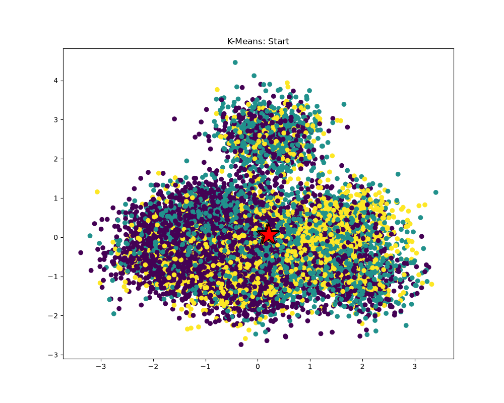
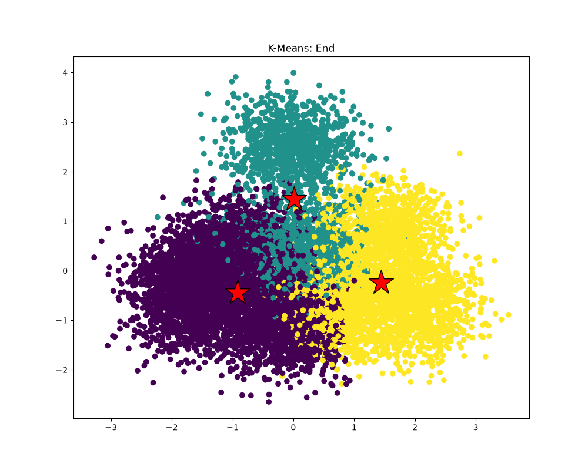

# Лабораторная работа 5

Полная задача и требования описаны в [удалённом репозитории](https://github.com/stanford-cs149/asst1). Была выбрана задача №6: **"Program 6: Making K-Means Faster (15 points)"**.

## Задача

Профилировать [kmeansThread](../../src/lab_05/kmeansThread.cpp), используя [CycleTimer](../../src/lab_05/common/CycleTimer.h), с целью найти узкое место алгоритма. Необходимо оптимизировать алгоритм: он должен быть ускорен минимум в `2.1 раза`.

## Предварительная оценка функций основного цикла [kmeansThread](../../src/lab_05/kmeansThread.cpp)

* **computeAssignments**: `O(M * N * K)`;
* **computeCentroids**: `O(M * N)`;
* **computeCost**: `O(M * N)`,

где `M` - число точек, `N` - размерность точки, `K` - число кластеров.

## Технические характеристики устройств

```text
Kernel: Linux 6.18.48-1-cachyos-lts
Shell: fish 4.9.3
CPU: AMD Ryzen 5 7535HS (12) @ 4.60 GHz
GPU 1: NVIDIA GeForce RTX 4060 Max-Q / Mobile [Discrete]
GPU 2: AMD Radeon 680M [Integrated]
Memory: 14.86 GiB
```

## Результаты замеров исходной реализации [kmeansThread](../../src/lab_05/kmeansThread.cpp)

|       M |    N |    K | computeAssignments | computeCentroids | computeCost |  total time |
| ------: | ---: | ---: | -----------------: | ---------------: | ----------: | ----------: |
| 1000000 |  100 |    3 |            74.523% |           0.704% |     24.773% | 92227.262ms |
| 1000000 |  100 |    6 |              85.4% |           0.403% |     14.197% | 86989.039ms |

Среднее время выполнения алгоритма равно `≈89608.151ms`. Исходная реализация алгоритма имеет слабое место - функция `computeAssignments`, которая в среднем занимает `≈79.962%` общего времени выполнения алгоритма.

## Оптимизация

В исходной реализации `start` и `end` в `WorkerArgs` задавали диапазон кластеров, а внутри каждого кластера функция проходила по всем `M` точкам. Поэтому распараллеливание этой функции было ограничено `K` потоками, а каждый проход заново обрабатывал весь массив данных.

В новой версии работа делится по точкам: `M ≫ K`, и точки независимы друг от друга. Диапазон `[start, end)` теперь задаёт точки, и для каждой точки функция вычисляет расстояния до всех K центроидов и сразу выбирает минимальное:

```cpp
void computeAssignments(WorkerArgs *const args) {
  for (int m = args->start; m < args->end; m++) {
    double minDist = 1e30;
    int best = -1;
    for (int k = 0; k < args->K; k++) {
      double d = dist(&args->data[m * args->N],
                      &args->clusterCentroids[k * args->N], args->N);
      if (d < minDist) {
        minDist = d;
        best = k;
      }
    }
    args->clusterAssignments[m] = best;
  }
}
```

Каждый поток получает свой объект `WorkerArgs` со своими `start` и `end`. Потоки пишут в непересекающиеся элементы `clusterAssignments` и только читают данные и центроиды, поэтому гонок данных нет и синхронизация не нужна. Число потоков равно `6` - число физических ядер процессора. Размер блока считается с округлением вверх:

```cpp
int chunk = (M + NUM_THREADS - 1) / NUM_THREADS;
threadArgs[t].start = min(t * chunk, M);
threadArgs[t].end   = min((t + 1) * chunk, M);
```

Округление вверх гарантирует, что ни одна точка не будет потеряна если `M` не кратном числу потоков, а `min(..., M)` обрезает диапазон последнего потока до реального.

Функции `computeCentroids` и `computeCost` остались последовательными, так как по условию задания распараллеливать следует только одну функцию. Перед их вызовом `start` и `end` возвращаются к `0` и `K` соответственно, потому что `computeCost` использует их как диапазон кластеров.

Функция `dist`, условие сходимости и порядок обхода кластеров не менялись, поэтому назначения точек те же, что и в исходной версии.

## Результаты замеров оптимизированной реализации [kmeansThread](../../src/lab_05/kmeansThread.cpp)

|       M |    N |    K | computeAssignments | computeCentroids | computeCost |  total time |
| ------: | ---: | ---: | -----------------: | ---------------: | ----------: | ----------: |
| 1000000 |  100 |    3 |             33.89% |           1.778% |     64.332% | 35857.031ms |
| 1000000 |  100 |    6 |             50.48% |           1.258% |     48.262% | 25676.341ms |

Среднее время выполнения алгоритма равно `30766.686ms`. Слабое место исходной реализации алгоритма устранено - функция `computeAssignments` в среднем занимает `≈42.185%` общего времени выполнения алгоритма.

## Анализ графиков



**Рисунок 1: исходные данные**



**Рисунок 2: работа исходного алгоритма**


**Рисунок 3: работа оптимизированного алгоритма**

Графики, построенные `plot.py` на основе работы исходного алгоритма и оптимизированного алгоритма, соответствуют требуемому виду.

## Результат

`K = 3`: $$\frac{oldTotalTime}{newTotalTime} = \frac{92227.262}{35857.031} ≈ 2.572$$
`K = 6`: $$\frac{oldTotalTime}{newTotalTime} = \frac{86989.039}{25676.341} ≈ 3.388$$

Производительность алгоритма повысилась: при `K = 3` в `≈2.572 раза`; при `K = 6` в `≈3.388 раза`; в среднем в `2.98 раза`, что позволяет считать поставленную задачу выполненной.

## Вывод

Узким местом алгоритма была функция `computeAssignments`. Распараллеливание по точкам вместо кластеров и смена порядка циклов дали ускорение в среднем в `2.98 раза`, что превышает требуемые `2.1`. Дальнейшее ускорение ограничено последовательными `computeCost` и `computeCentroids`.